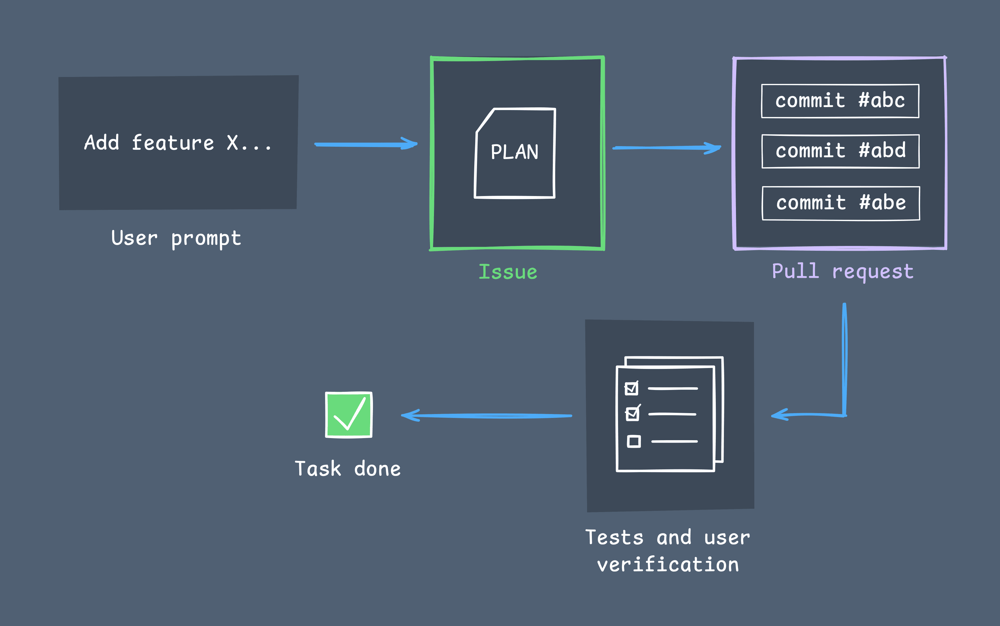
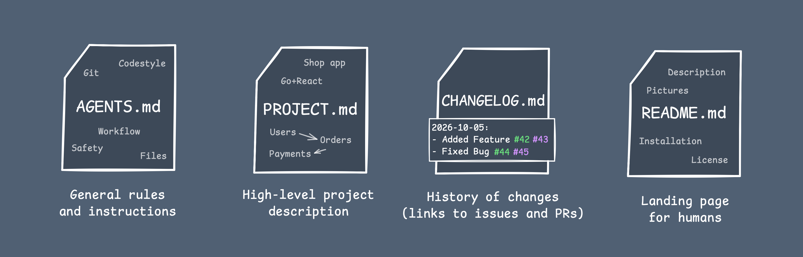

+++
title = "Concept of an Auto Repository"
date = 2026-10-27
[extra]
toc = true
go_to_top = true
+++

In this article, I will describe a simple and straightforward way of automating work in code repositories using LLM agents. It requires no messy setup - just existing Git features and some text files. 

## Issues and Pull Requests

The development loop consists of these steps:

1. The user writes an instruction for the agent (implement a feature, fix a bug, etc.).
2. The agent writes a high-level plan for implementing the user's request.
3. The user validates the plan (makes corrections, asks questions) and approves it.
4. The agent implements the plan in a new branch (using external tools, web search, project context, etc.).
5. The implementation is validated by the agent (through tests, builds, snapshots, etc.) and manually by the user.
6. The valid implementation is merged into the master branch.

For plans, we use regular issues (each accepted plan is a new issue). For implementing an issue, we use a pull request (a group of commits that implement a plan) in a separate branch. When plan is implemented, tested and verified - we just merge it into master branch.

## Files

Next, we need to set up rules and context for the project. For this, we need some files.

### AGENTS.md

This is the main file with rules that, by [convention](https://agents.md), is loaded by every modern agent at the start of each new session. It contains all general rules (how to work with this repository). At a bare minimum, I divided it into five chapters that include instructions on how the agent should work in this repository (task workflow, context files and history, code style, Git rules, and safety). The last chapter contains project-specific rules, which you are free to fill in for that specific project.

### PROJECT.md

This is the file with a high-level project description. Briefly: what this project is, how it works, what parts it consists of, and how they are related. 

There is a lot of room for improvement in this part. It may go beyond a simple file - it may be a vector database with semantic search, a folder with many files each containing a description of a specific part of the project, or something else. But for now, for simplicity, it is a single file, which is suitable for most projects.

At the start of a new project, this file must describe the minimum version of the future project that the agent can begin implementing. Later, as the project evolves, this file will be automatically modified by the agent.

### CHANGELOG.md

This is the file that tracks a brief history of project changes. It also contains links to the corresponding issues and pull requests. So it may be very useful in the agent's context when fixing bugs or continuing the evolution of parts of the program.

### README.md

This is the file for humans. It contains all information about the project (what it is, how to use it, etc.) but is written specifically for humans, not agents. It is highly recommended to manage this file manually.

## Recap

The minimal template of such "Autorepo" is published [here](https://github.com/cheatsnake/autorepo). This is a very small setup, but I actually think it shouldn’t be complicated, because the agent’s goal is to implement tasks within the repository’s codebase while following the specified rules.
